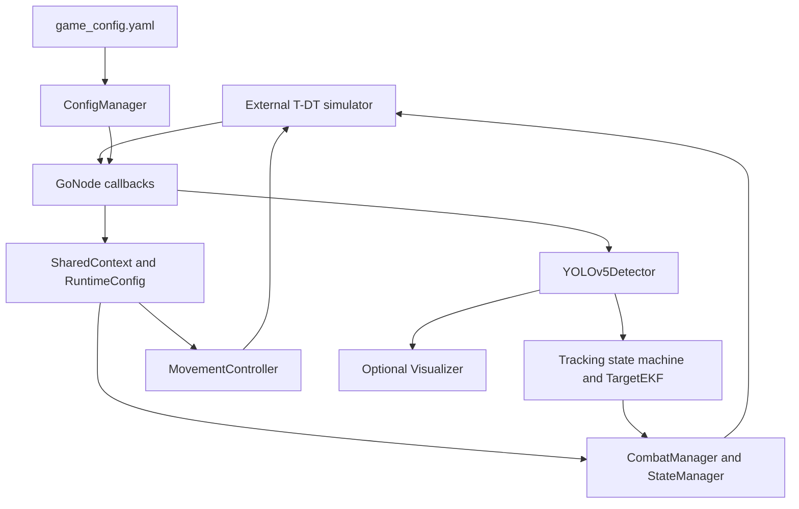

# Architecture

## Data flow

## Module responsibilities

| Module | Responsibility |
| --- | --- |
| `go_d2c2.cpp` | Parse player/test arguments, construct the node, run a two-thread executor. |
| `GoNode` | Load and validate configuration, wire subscriptions/publishers, create modules and timers. |
| `ConfigManager` | Parse YAML into typed `GameConfig`; report loading errors. |
| `RuntimeConfig` | Runtime parameter values assembled by `loadConfigParameters()`. |
| `SharedContext` | State exchanged between controllers; grouped state uses mutex access and flags use atomics. |
| `MovementController` | Navigation, arrival checks, retry behavior, and position holding. |
| `PathNavigator` / `PathStrategy` | Track visitation indices; coordinates remain in the YAML configuration. |
| `CombatManager` | Integrate detector, tracking, and simulator task commands. |
| `StateManager` | React to simulator health changes and task transitions. |
| `YOLOv5Detector` | TensorRT inference, post-processing, and geometric calculations. |
| `TargetEKF` / `GeneralKalmanFilter` | Three-state tracking and innovation statistics. |
| `Visualizer` | Optional GUI work separate from image callbacks. |
| `TimeManager` / `DataManager` | Simulator time and bounded history used by controllers. |

## ROS2 topics

Replace `N` with `1` or `2` for the selected player.

| Direction | Topic | Message |
| --- | --- | --- |
| Subscribe | `/position_player_N` | `geometry_msgs/msg/PoseStamped` |
| Subscribe | `/real_angles_player_N` | `tdt_interface/msg/ReceiveData` |
| Subscribe | `/camera_image_player_N` | `sensor_msgs/msg/Image` |
| Subscribe | `/game_healths` | `std_msgs/msg/Int32MultiArray` |
| Subscribe | `/game_time` | `std_msgs/msg/Int32` |
| Publish | `/target_speed_player_N` | `geometry_msgs/msg/TwistStamped` |
| Publish | `/target_angles_player_N` | `tdt_interface/msg/SendData` |

Health messages use a fixed twelve-entry layout, six entries per team. Waypoint-to-opponent mapping and the eleven-waypoint assumption are competition-specific; see `waypoint_utils` and its tests.

## Callbacks and concurrency

The movement control timer has its own mutually exclusive callback group. The remaining timers and subscriptions share another mutually exclusive group, with a two-thread executor. A configured timer period is a requested scheduling interval, not a measured deadline guarantee. Visualization uses a separate worker when enabled.

## Configuration

`src/go/config/game_config.yaml` is the source for both teams' waypoints and runtime parameters. `GoNode` exposes `config_path` and `engine_path` ROS parameters. It refuses startup when the configuration is missing or fails validation. Runtime defaults are not a substitute for the required YAML waypoint tables.

Do not infer units from parameter names alone. The loader converts selected values using `unit.meter_to_map_unit`, while some navigation thresholds are consumed directly in simulator map units. Camera intrinsics and armor geometry must match the input scene. Existing inline implementation notes are retained for maintainers; these English guides describe the current public entry points.

## Model compatibility

The runtime queries tensors named `images` and `output0`, uses a static batch of one, and reads float buffers. Its post-processing expects channel-first boxes with four coordinates followed by two class scores, without a separate objectness channel. An engine exported by another YOLO family or with integrated NMS is not automatically compatible. New training defaults to Ultralytics YOLOv5u, which differs from the original anchor-based YOLOv5 repository. Validate tensor names, shape, preprocessing, and numerical output before treating an export as a working deployment.
